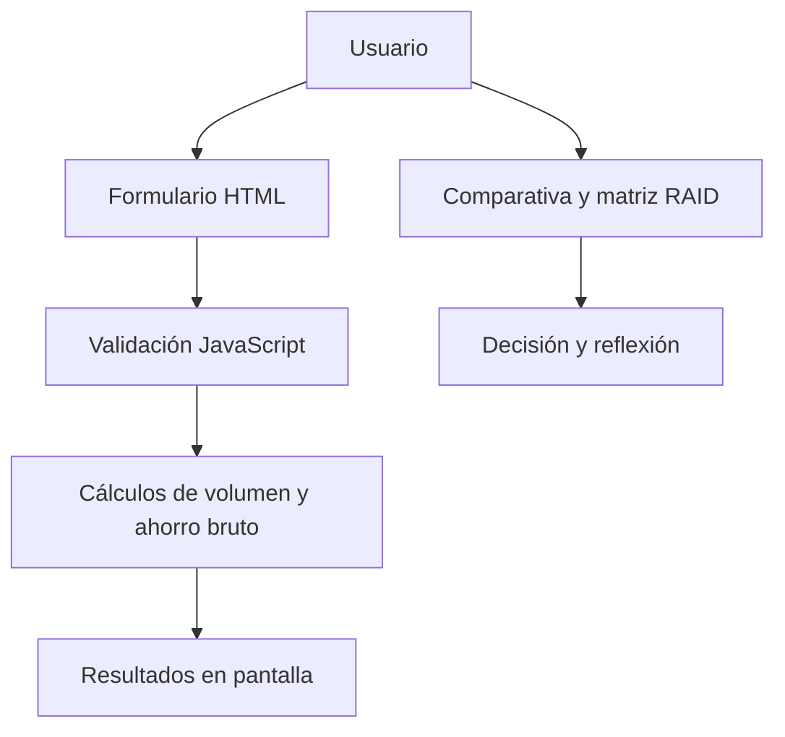

# M4-S26 — Evaluación técnico-económica de integración de IA

Aplicación web estática para analizar la viabilidad preliminar de incorporar IA generativa en un proceso de atención al cliente B2B.

> **Estado:** herramienta de análisis académico/portfolio. Los resultados son estimaciones basadas en supuestos editables, no una previsión financiera ni una cotización de proveedor.

## Pregunta que responde

¿Cuánto volumen de consultas y tokens podría generar el caso, qué ahorro de tiempo humano bruto se estima y qué riesgos deben resolverse antes de lanzar un piloto?

## Funcionalidades

- Estimación mensual de consultas y tokens de entrada/salida.
- Cálculo del tiempo humano ahorrado y su valoración económica bruta.
- Validación de entradas vacías, negativas, no finitas y combinaciones incoherentes.
- Identificación de retos técnicos, económicos, organizativos y de privacidad.
- Comparativa cualitativa entre API externa y cloud gestionado.
- Registro RAID de riesgos, supuestos, incidencias y dependencias.
- Decisión recomendada con controles y métrica de éxito.

## Arquitectura



La aplicación no necesita backend: los cálculos se realizan en el navegador con los valores introducidos.

## Caso base y cálculo reproducible

| Variable | Valor |
|---|---:|
| Tickets mensuales | 12.000 |
| Consultas IA por ticket | 2 |
| Tokens de entrada por consulta | 2.500 |
| Tokens de salida por consulta | 600 |
| Tiempo actual por ticket | 12 min |
| Tiempo esperado con IA | 8 min |
| Coste hora soporte | 22 € |

Con esos supuestos:

| Indicador | Resultado |
|---|---:|
| Consultas mensuales | 24.000 |
| Tokens de entrada | 60.000.000 |
| Tokens de salida | 14.400.000 |
| Tiempo ahorrado por ticket | 4 min |
| Horas liberadas al mes | 800 h |
| Ahorro humano bruto estimado | 17.600 €/mes |

**Fórmulas:** consultas = tickets × consultas por ticket; tokens = consultas × tokens por consulta; horas liberadas = tickets × (tiempo actual − tiempo con IA) ÷ 60; ahorro bruto = horas liberadas × coste horario.

## Interpretación económica

El valor de 17.600 €/mes es ahorro humano bruto teórico. No descuenta coste de tokens, licencias, configuración, integración, mantenimiento, formación, supervisión humana, observabilidad ni posibles errores/retrabajo. Tampoco implica que se reduzca plantilla: el tiempo liberado puede traducirse en capacidad adicional o menor tiempo de respuesta.

Para estimar ahorro neto hacen falta precios reales del modelo, consumo medido, coste de operación y una tasa de adopción validada mediante piloto.

## Uso

Abre `index.html` en un navegador moderno o utiliza GitHub Pages. No necesita instalación ni backend.

## Validaciones y pruebas

La aplicación rechaza entradas vacías o negativas, exige enteros para tickets/consultas/tokens y no permite que el tiempo esperado con IA supere el tiempo actual.

```bash
node --check script.js
node --test tests/*.test.cjs
```

GitHub Actions ejecuta las comprobaciones y las pruebas de humo.

## Límites y evolución

- La matriz API/cloud es cualitativa y estática; no representa benchmarking de proveedores.
- No se calcula coste de inferencia ni ahorro neto.
- La reducción de tiempo es una hipótesis que debe medirse en un piloto.
- No se conecta a CRM, ticketing ni servicios de IA.
- Próximos pasos: añadir precios configurables por modelo, coste de integración/operación, sensibilidad por escenarios y resultados observados del piloto.

## Privacidad

No introduzcas tickets reales, datos personales, información confidencial ni claves API.
